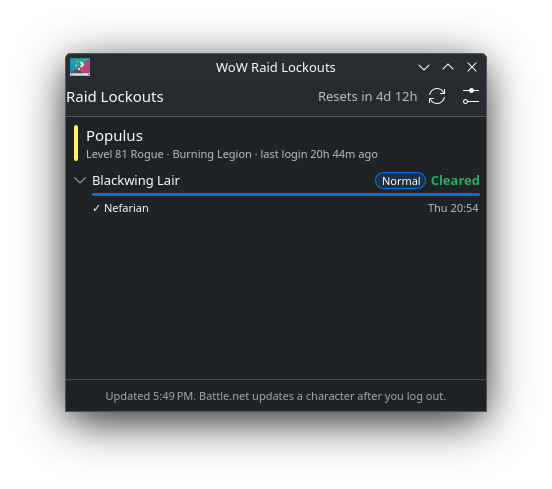

# WoW Raid Lockouts — KDE Plasma widget

A Plasma 6 widget that answers one question: **which raids are my characters saved to this week?**
It reads boss kills from Blizzard's official Battle.net API and clears them by itself at the
weekly reset.



## Features

- Every raid (and, optionally, Mythic dungeon) each character has killed a boss in since the
  last weekly reset, with difficulty and bosses killed, such as *Heroic 6/8*
- Click a lockout to see which bosses are down and when they died
- Several characters, including ones on different realms
- Countdown to the weekly reset for your region; lockouts disappear the moment it passes
- Panel icon with the number of lockouts this week, and optionally the time until the reset

## Install

From the KDE Store: *Add Widgets… → Get New Widgets… → Download New Plasma Widgets* and search for
**WoW Raid Lockouts**.

Or download `wow-lockouts-1.1.0.plasmoid` from the releases page and run:

```sh
kpackagetool6 -t Plasma/Applet -i wow-lockouts-1.1.0.plasmoid
```

Or from source:

```sh
git clone https://github.com/p145085/plasma-wow-lockouts.git
kpackagetool6 -t Plasma/Applet -i plasma-wow-lockouts/package
```

Upgrade with `kpackagetool6 -t Plasma/Applet -u plasma-wow-lockouts/package` (or `-u` with the
`.plasmoid` file).

Then right-click your panel or desktop, choose *Add Widgets…*, and drag **WoW Raid Lockouts** onto it.

## Setup: connect your characters

The widget needs a Battle.net **API client** to talk to Blizzard. Creating one is free, takes a
minute, and you only do it once. You don't give the widget your Battle.net password, and it can't
see or change anything on your account: it only reads public character profiles, the same data
the Armory shows.

### 1. Create a Battle.net API client

1. Go to <https://develop.battle.net/access/clients> and sign in with your Battle.net account.
   The first time, you may need to accept the API terms and verify your email address.
2. Click **Create Client**.
3. Fill in the form:
   - **Client Name:** anything, for example `Plasma lockouts`
   - **Redirect URLs:** leave empty (if the form insists, enter `http://localhost`)
   - **Service URL:** leave empty
   - **Intended Use:** for example `Personal desktop widget showing my raid lockouts`
4. Save. You now see a **Client ID** and a **Client Secret**. Keep this page open.

### 2. Configure the widget

1. Right-click the widget and choose **Configure WoW Raid Lockouts…** (or click the gear icon in
   the widget).
2. **Region:** the region your characters play in (Americas & Oceania, Europe, Korea or Taiwan).
3. **Client ID** and **Client secret:** paste them from the Battle.net page.
4. **Characters:** one per line as `Name-Realm`, the way the game writes cross-realm names:

   ```
   Thrall-Argent Dawn
   Jaina-Stormscale
   ```

   Capitals, spaces, dashes and apostrophes in the realm name don't matter: `Argent Dawn`,
   `ArgentDawn` and `argent-dawn` all work.
5. Click **Test**. You should see a green line per character with its level, class and how many
   lockouts it has this week. Then click **OK**.

### Troubleshooting

| Message | What to do |
|---|---|
| *Battle.net rejected the client ID or secret* | Copy both again from develop.battle.net. You may have copied a space, or the secret was regenerated. |
| *Character not found* | Check the spelling, the realm and the **region**. Brand-new characters and characters that haven't logged in for a long time only appear after you log in once. |
| A boss you just killed doesn't show | Battle.net only updates a character after you **log out** (or change character), and can take a few minutes after that. |
| The reset time is off for your region | Set the weekly reset day and hour (UTC) by hand under *Weekly reset* in the settings, and please open an issue. |

## How it works

Every 30 minutes (configurable) the widget fetches each character's
[encounters/raids](https://develop.battle.net/documentation/world-of-warcraft/profile-apis) profile,
which lists when each boss was last killed on each difficulty. Any boss killed after the most recent
weekly reset is a lockout. Weekly resets are:

| Region | Reset (UTC) | |
|---|---|---|
| Americas & Oceania | Tuesday 15:00 | |
| Europe | Wednesday 04:00 | |
| Korea, Taiwan | Wednesday 23:00 | not verified, override in settings if wrong |

The widget shows them in your local time.

Limitations of the public API:

- The data is per boss, not per raid ID, so it can't show *which* Mythic lockout you are saved to,
  only which bosses are dead. For Normal, Heroic and LFR, which have per-boss loot lockouts,
  that is the whole story.
- For raids from Classic to Wrath, Blizzard only tracks some bosses, often just the last one
  (Blackwing Lair: Razorgore and Nefarian). Killing the final boss shows the raid as **Cleared**,
  since you can't reach it without clearing the rest.
- Updates arrive after you log out, not live. For exact in-game lockouts there's `/raidinfo`, or
  the SavedInstances addon.
- China (battlenet.com.cn) isn't supported.

## Privacy

The client ID and secret are stored in plain text in your Plasma config
(`~/.config/plasma-org.kde.plasma.desktop-appletsrc`), like the rest of the widget's settings. They
only grant access to Blizzard's public game data, but don't share them. If you think they leaked,
open the client on develop.battle.net, generate a new secret, and paste the new one into the widget.

The widget only talks to `oauth.battle.net` and `<region>.api.blizzard.com`.

## Build a .plasmoid

```sh
cd package && zip -r ../wow-lockouts-1.1.0.plasmoid . && cd ..
```

## Notes

Not affiliated with or endorsed by Blizzard Entertainment. World of Warcraft and Battle.net are
trademarks of Blizzard Entertainment, Inc.

## License

GPL-3.0-or-later
